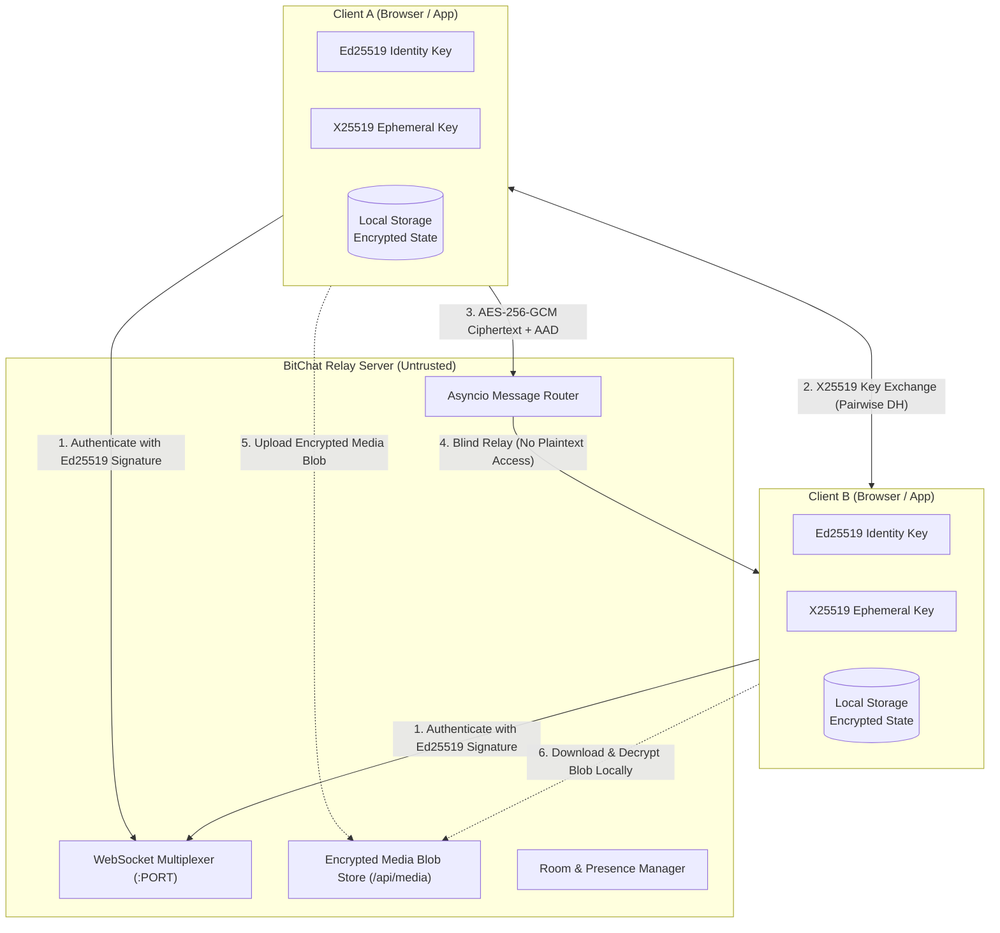

<div align="center">

# ⚡ BitChat

**Zero-Knowledge • Phone-Numberless • Fail-Closed End-to-End Encrypted Communication Platform**

*Discord's sleek aesthetics meets Signal's cryptographic guarantees.*

[](https://github.com/Sujay-korde/BitChat)
[](https://opensource.org/licenses/MIT)
[](https://python.org)
[](https://react.dev)
[](https://www.typescriptlang.org)

<p align="center">
  <a href="#-features">Features</a> •
  <a href="#-architecture--cryptography">Architecture</a> •
  <a href="#-quick-start">Quick Start</a> •
  <a href="#-comparison">Comparison</a> •
  <a href="#-deploy">Deployment</a> •
  <a href="#-security-guarantees">Security Guarantees</a>
</p>

</div>

---

## 🌟 Overview

Most modern messaging applications force users to sacrifice privacy for convenience. They require phone numbers for KYC/identity tracking, store conversation metadata on centralized servers, or implement proprietary encryption backdoors.

**BitChat** is built on a single, uncompromising principle: **Zero Server Trust**.
Identity is strictly a client-side cryptographic key pair. The server acts exclusively as an untrusted message router and blind binary blob relay. Plaintext messages, group ratchets, and media encryption keys never touch the network unencrypted.

---

## ✨ Features

- 🔑 **No Phone Numbers or Emails:** Generate an Ed25519 identity key client-side in milliseconds. No KYC, no phone verification, no email correlation.
- 🔒 **Pairwise Direct Messaging (E2EE):** X25519 Diffie-Hellman ephemeral key exchange with HKDF-SHA256 key derivation and AES-256-GCM authenticated encryption.
- 👥 **Group Channels (Megolm Sender-Key Protocol):** Efficient multi-party encryption with forward secrecy and ratchet trees. Rooms fan-out without server message inspection.
- 📎 **Out-of-Band Encrypted Media Store:** Images, audio, videos, and files are encrypted client-side with unique AES-256-GCM keys and uploaded as opaque binary blobs to `/api/media`. Only recipients holding the encrypted descriptor can decrypt and view attachments.
- 🎨 **Discord-Style Modern Dark UI:** Sleek slate aesthetic (`#313338`), channels (`#`), direct messages (`@`), message timelines, real-time presence indicators, and offline history persistence.
- 🛡️ **Anti-Impersonation & Anti-Replay:** Per-message monotonic sequence counters and strict Associated Authenticated Data (AAD) binding sender, target, type, and key version.
- 💾 **Persistent Client-Side Storage:** Chats and cryptographic state persist locally under client-isolated storage across sessions and reloads.
- ⚡ **Ultra-Low Latency:** Asynchronous non-blocking architecture powered by Python `asyncio`, WebSockets, and WebCrypto API.

---

## 📊 Comparison

| Feature | **BitChat** | **Discord** | **WhatsApp** | **Telegram** | **Signal** |
| :--- | :---: | :---: | :---: | :---: | :---: |
| **No Phone Number Required** | ✅ **Yes** | ❌ No (SMS verify) | ❌ No | ❌ No | ❌ No |
| **Zero-Knowledge Architecture** | ✅ **Yes** | ❌ No | ❌ No | ❌ No | ⚠️ Partial |
| **Group E2EE Encryption** | ✅ **Megolm Ratchet** | ❌ None | ✅ Yes | ❌ No (Secret chat only) | ✅ Yes |
| **Out-of-Band Media Encryption** | ✅ **Client AES-GCM** | ❌ Plain CDN | ⚠️ Cloud relay | ❌ Plain Cloud | ✅ Yes |
| **Anti-Replay Protection (AAD)** | ✅ **Enforced** | ❌ No | ✅ Yes | ⚠️ Partial | ✅ Yes |
| **Self-Hostable (1-Click Docker)** | ✅ **Yes** | ❌ No | ❌ No | ❌ No | ⚠️ Complex |
| **Open Source** | ✅ **MIT** | ❌ Proprietary | ❌ Proprietary | ⚠️ Client only | ✅ GPLv3 |

---

## 🏗️ Architecture & Cryptography



### Cryptographic Primitives

- **Digital Signatures:** Ed25519 for non-repudiable server authentication and identity verification.
- **Key Agreement:** X25519 Elliptic-Curve Diffie-Hellman (ECDH).
- **Key Derivation:** HKDF-SHA256 with distinct salt and application-info strings.
- **Symmetric Cipher:** AES-256-GCM with 96-bit random IVs and 128-bit authentication tags.
- **Authenticated Additional Data (AAD):**
  $$\text{AAD} = \text{Version} \parallel \text{MsgType} \parallel \text{TargetType} \parallel \text{Target} \parallel \text{KeyVersion} \parallel \text{Sender} \parallel \text{Sequence}$$
  Guarantees that ciphertexts cannot be spliced, modified, redirected, or replayed.

---

## 🚀 Quick Start

### Option A: Use the Live Public Cloud Deployment

1. Open the web app: [https://bitchat-client.vercel.app](https://bitchat-client.vercel.app) *(or your Vercel deployment)*
2. In the **SERVER** box, click **`⚡ Cloud (Railway)`** (`wss://bitchat-prod-production.up.railway.app`).
3. Pick any handle and start chatting securely!

---

### Option B: Run Locally

#### 1. Clone the repository
```bash
git clone https://github.com/Sujay-korde/BitChat.git
cd BitChat
```

#### 2. Start the Backend Server (Python 3.11+)
```bash
# Set up virtual environment
python -m venv .venv

# On Linux/macOS:
source .venv/bin/activate
# On Windows:
.venv\Scripts\activate

# Install dependencies
pip install -e .[dev]

# Start standalone server (TCP: 8765, WS: 8766, Media: 8767)
python -m securechat.server.main
```

#### 3. Start the Web Client
In a separate terminal:
```bash
cd web
npm install
npm run dev
```

Open [http://localhost:5173](http://localhost:5173) in your browser. Choose **`💻 Localhost (127.0.0.1)`** and enter your identity.

---

## 🧪 Testing & Verification

BitChat is covered by an exhaustive test suite verifying cross-runtime cryptographic interoperability between Python and Browser WebSockets/WebCrypto:

```bash
# Run backend cryptographic & resilience test suite (45 tests)
pytest tests -v

# Run web client & architecture tests (24 tests)
cd web
npm test
```

Test coverage includes:
- [x] End-to-end messaging and Megolm group key ratchets
- [x] Python $\longleftrightarrow$ Browser WebCrypto cross-decryption
- [x] Malicious replay and out-of-order sequence rejection
- [x] Identity impersonation and unauthorized key distribution prevention
- [x] Out-of-band attachment encryption & integrity verification
- [x] Clean architecture constraint validation (UI isolation from crypto primitives)

---

## 🐳 Docker Deployment

Run the single-container cloud multiplexer (WebSockets, REST Media API, and Health Check on a unified port):

```bash
# Build the Docker image
docker build -t bitchat-server .

# Run container
docker run -p 8080:8080 -e PORT=8080 bitchat-server
```

---

## 🔒 Security Model & Threat Analysis

| Threat | Mitigation Strategy |
| :--- | :--- |
| **Server Compromise / Rogue Admin** | Fail-closed E2EE. All keys exist solely in client memory/storage. The server cannot read plaintext or forge messages. |
| **Man-in-the-Middle (MITM)** | Public keys are signed using Ed25519 identity keys and compared using visual fingerprints. |
| **Replay Attacks** | Strictly monotonic 64-bit sequence counters verified inside AES-GCM Authenticated Additional Data (AAD). |
| **Metadata Mining** | No phone numbers, real names, contacts, or location data collected or stored. |
| **Media Interception** | Out-of-band media blobs are encrypted with ephemeral AES-256 keys prior to HTTP upload. Decryption keys are transferred exclusively within E2EE payloads. |

---

## 🛣️ Roadmap

- [x] Complete Ed25519 authentication and anti-impersonation
- [x] Megolm-style sender-key group encryption
- [x] Zero-knowledge encrypted media store
- [x] Modern Discord-style dark interface
- [x] LocalStorage conversation & contact persistence
- [ ] Multi-device cryptographic session syncing
- [ ] End-to-end encrypted WebRTC audio & video calls
- [ ] Native mobile apps (Tauri / React Native)
- [ ] Tor / Onion routing integration for metadata obfuscation

---

## 🤝 Contributing

Contributions make the open-source community an amazing place to learn, inspire, and create. Any contributions you make are **greatly appreciated**.

1. Fork the Project
2. Create your Feature Branch (`git checkout -b feature/AmazingFeature`)
3. Commit your Changes (`git commit -m 'Add some AmazingFeature'`)
4. Push to the Branch (`git push origin feature/AmazingFeature`)
5. Open a Pull Request

---

## 📄 License

Distributed under the **MIT License**. See [`LICENSE`](LICENSE) for more information.

---

<div align="center">
  <sub>Built with ❤️ for privacy and sovereignty by <a href="https://github.com/Sujay-korde">Sujay Korde</a>. If you find this project valuable, please consider giving it a ⭐!</sub>
</div>
