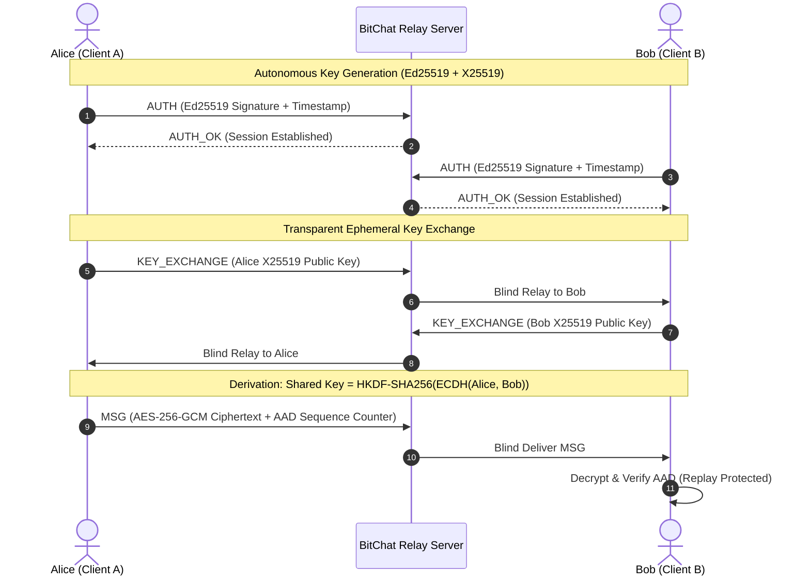

<div align="center">

# ⚡ BitChat

**Next-Generation Sovereign Cryptographic Communication Platform**

*High-Performance Real-Time Messaging • Autonomous Cryptographic Identity • Zero-Knowledge Core*

[](https://github.com/Sujay-korde/BitChat)
[](https://opensource.org/licenses/MIT)
[](https://python.org)
[](https://react.dev)
[](https://www.typescriptlang.org)

<p align="center">
  <a href="#-philosophy">Philosophy</a> •
  <a href="#-features">Features</a> •
  <a href="#-protocol-specification">Protocol</a> •
  <a href="#-architectural-overview">Architecture</a> •
  <a href="#-quick-start">Quick Start</a> •
  <a href="#-security-guarantees">Security Guarantees</a>
</p>

</div>

---

## 🧭 Philosophy

Traditional messaging networks were designed around a surveillance premise: tethering identity to state-issued telecom phone numbers, aggregating metadata on centralized servers, and operating opaque cloud databases.

**BitChat** was engineered from first principles to challenge this status quo. We believe that private communication is an inviolable digital human right. 

In BitChat:
1. **Identity is Cryptographic Sovereignty:** No phone numbers, no emails, no SMS verification. Your identity is an autonomous Ed25519 cryptographic key pair generated exclusively on your local device.
2. **Zero-Trust Network Fabric:** The server is treated as an actively untrusted relay. It forwards blind binary frames and hosts encrypted blobs without ever possessing the keys to decrypt content, metadata mappings, or group ratchets.
3. **Fail-Closed by Design:** If an encryption handshake is pending or compromised, communication halts safely rather than degrading to unencrypted fallback.

---

## ✨ Features

- 🔑 **Autonomous Identity:** Instant client-side key generation with zero personal data collection. No phone number or account approval required.
- 🔒 **Pairwise Direct Encryption:** X25519 Elliptic-Curve Diffie-Hellman ephemeral key exchange paired with HKDF-SHA256 key derivation and AES-256-GCM authenticated encryption.
- 👥 **Megolm Multi-Party Group Ratchet:** High-efficiency sender-key group cryptography with ratchet forward secrecy, enabling scalable rooms without server-side plaintext exposure.
- 🛡️ **Anti-Replay & Tamper Proofing:** Strictly monotonic sequence counters and comprehensive Authenticated Additional Data (AAD) binding message headers, sender, target, and protocol version.
- 📎 **Blind Blob Media Vault:** Media, documents, and attachments are encrypted client-side with ephemeral AES-256 keys. The server hosts only ciphertext blobs at `/api/media`; decryption keys are exchanged exclusively via E2EE payloads.
- 🎨 **Obsidian Slate Interface:** High-contrast, minimalist dark workspace engineered for technical precision, persistent conversation streams, and real-time cryptographic status telemetry.
- 💾 **Decentralized Local Persistence:** Decrypted message history and cryptographic ratchet state persist strictly on the client device across sessions and reloads.
- ⚡ **High-Throughput Asynchronous Core:** Built on Python's non-blocking `asyncio` networking engine and native browser WebCrypto API for sub-millisecond encryption and delivery.

---

## 🏛️ Architectural Comparison

| Dimension | **Legacy Centralized Networks** | **BitChat Sovereign Protocol** |
| :--- | :--- | :--- |
| **Identity Anchoring** | Telecom cellular numbers & email correlation | Autonomous Ed25519 public key cryptography |
| **Server Trust Level** | Full Trust (Server reads metadata, routing, contacts) | Zero Trust (Untrusted blind relay) |
| **Direct Message Security** | Proprietary or centralized key escrow | X25519 ECDH + AES-256-GCM authenticated sessions |
| **Multi-Party Channels** | Unencrypted server-side databases | Decentralized Megolm Sender-Key Ratchets |
| **Media Attachments** | Plaintext cloud storage buckets | Client-side encrypted blobs with out-of-band key transfer |
| **Replay & Injection Defense** | Server timestamps | Client-verified Monotonic 64-bit Sequence + AAD |
| **Deployment Model** | Walled garden proprietary silo | 100% Open Source (MIT), self-hostable in 1 click |

---

## 🔬 Protocol Specification & Cryptography



### Cryptographic Foundation

- **Digital Signature Scheme:** Ed25519 for non-repudiable entity authentication and anti-impersonation.
- **Key Agreement:** X25519 Elliptic-Curve Diffie-Hellman (ECDH) over Curve25519.
- **Key Derivation Function:** HKDF-SHA256 with distinct contextual salt and info domains.
- **Authenticated Encryption:** AES-256-GCM with unique 96-bit random IVs and 128-bit authentication tags.
- **AEAD Authenticated Additional Data (AAD):**
  $$\text{AAD} = \text{Version} \parallel \text{MsgType} \parallel \text{TargetType} \parallel \text{Target} \parallel \text{KeyVersion} \parallel \text{Sender} \parallel \text{Sequence}$$

---

## 🚀 Quick Start

### 1. Web Application

Access the production deployment directly in your browser:
**[https://bitchat-client.vercel.app](https://bitchat-client.vercel.app)** *(or your local instance)*

Select **`⚡ Cloud (Railway)`** to connect to the global relay node (`wss://bitchat-prod-production.up.railway.app`), choose an identity, and start communicating immediately.

---

### 2. Local Development & Self-Hosting

#### Prerequisites
- Python 3.11 or higher
- Node.js 18+ and npm

#### A. Start the Backend Relay Server
```bash
# Clone the repository
git clone https://github.com/Sujay-korde/BitChat.git
cd BitChat

# Initialize Python virtual environment
python -m venv .venv

# Activate environment
# On Linux/macOS:
source .venv/bin/activate
# On Windows:
.venv\Scripts\activate

# Install dependencies and development tools
pip install -e .[dev]

# Start standalone server (TCP: 8765, WS: 8766, Media: 8767)
python -m securechat.server.main
```

#### B. Start the Web Client
In a second terminal window:
```bash
cd web
npm install
npm run dev
```

Navigate to [http://localhost:5173](http://localhost:5173), choose **`💻 Localhost (127.0.0.1)`**, and begin testing.

---

## 🧪 Comprehensive Verification Suite

BitChat maintains rigorous automated test coverage across protocol framing, cryptographic resilience, anti-replay defenses, and cross-runtime interoperability between Python and Browser WebCrypto:

```bash
# Run backend cryptographic & protocol test suite (45 tests)
pytest tests -v

# Run web client architecture & persistence suite (24 tests)
cd web
npm test
```

Verification Highlights:
- [x] Cross-runtime encryption interoperability (Python $\longleftrightarrow$ Browser WebCrypto)
- [x] Megolm sender-key group ratcheting and forward secrecy
- [x] Out-of-order packet and sequence replay rejection
- [x] Impersonation attack defenses and key verification
- [x] Zero-knowledge encrypted media upload, storage, and decryption integrity
- [x] Clean architecture boundaries preventing cryptographic leakages to UI layers

---

## 🐳 Containerized Deployment

Deploy a single-container instance with unified WebSocket and REST API multiplexing:

```bash
# Build container image
docker build -t bitchat-node .

# Run container on unified port
docker run -p 8080:8080 -e PORT=8080 bitchat-node
```

---

## 🛡️ Threat Analysis & Defense Strategy

| Threat Vector | Mitigation Strategy |
| :--- | :--- |
| **Compromised Host / Malicious Server** | Cryptographic zero-trust. Keys reside exclusively in client memory/isolated storage. Plaintext is unreachable by the server. |
| **Adversarial Man-in-the-Middle** | Ephemeral public keys are signed with Ed25519 identity keys and verified against visual cryptographic fingerprints. |
| **Packet Replay Attacks** | Strictly monotonic 64-bit sequence counters evaluated inside authenticated AAD. Replays are dropped immediately. |
| **Identity Correlation & Tracking** | Zero metadata collection. No cellular numbers, legal names, IP persistence, or social graph mining. |
| **Attachment Interception** | Out-of-band files are encrypted with unique AES-256 keys prior to transmission; keys are only shared within E2EE payloads. |

---

## 🛣️ Project Trajectory

- [x] Ed25519 autonomous identity generation & anti-impersonation
- [x] Pairwise X25519 Diffie-Hellman + AES-256-GCM sessions
- [x] Megolm-style sender-key group encryption
- [x] Out-of-band encrypted media storage
- [x] Obsidian slate dark user interface
- [x] Client-side persistent conversation storage
- [ ] Ephemeral disappearing message timers
- [ ] End-to-end encrypted WebRTC audio & video streams
- [ ] Cross-platform desktop binaries (Tauri / Rust)
- [ ] Onion / mixnet routing integration for IP-level anonymity

---

## 🤝 Community & Contributions

We welcome security researchers, cryptographers, and software engineers to contribute to BitChat.

1. Fork the repository
2. Create your feature branch (`git checkout -b feature/crypto-enhancement`)
3. Commit your changes (`git commit -m 'feat: implement post-quantum ratchet'`)
4. Push to your branch (`git push origin feature/crypto-enhancement`)
5. Open a Pull Request

---

## 📄 License

This project is licensed under the **MIT License**. See the [`LICENSE`](LICENSE) file for details.

---

<div align="center">
  <sub>Architected for digital autonomy and personal sovereignty by <a href="https://github.com/Sujay-korde">Sujay Korde</a>. If you stand for private communication, star the repository! ⭐</sub>
</div>
