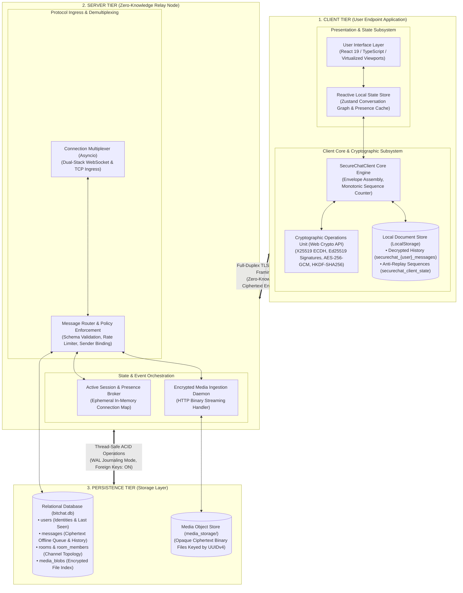
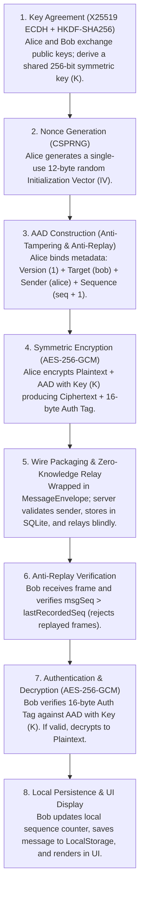
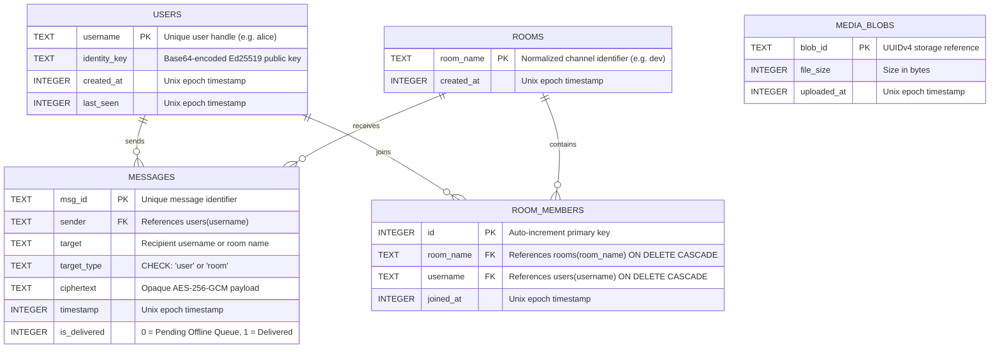

# BitChat — System Architecture & Protocol Specification

## 1. Executive Overview

**BitChat** is a zero-knowledge, local-first, end-to-end encrypted (E2EE) messaging platform engineered for high-assurance confidentiality, cryptographic integrity, and sovereign data ownership. 

The system implements a **Hybrid Zero-Knowledge Relational Architecture** (similar to Signal and WhatsApp):
* **Cryptographic Sovereignty**: Encryption and decryption occur strictly on client endpoints using **AES-256-GCM** with authenticated metadata binding (**AAD**), authenticated identity signatures (**Ed25519**), and ephemeral key exchange (**X25519 ECDH**).
* **Zero-Knowledge Transport & Relay**: The central server acts as an untrusted message router. It inspects only message routing metadata and never has access to encryption keys, plaintext message text, or media attachments.
* **ACID Relational Persistence**: An embedded **SQLite 3** relational database operates in WAL (Write-Ahead Logging) mode on the server to provide persistent offline store-and-forward queues, user registries, and channel topologies without violating zero-knowledge invariants.

---

## 2. Layered System Architecture Diagram (IEEE Block Style)



---

## 3. End-to-End Cryptographic Protocol Workflow

The diagram below details the 8 sequential stages of message delivery between two clients (Alice and Bob):



---

## 4. Database Architecture & Entity-Relationship Model (`bitchat.db`)

The server uses an embedded relational database to persist state across sessions without holding plaintext:



### Relational Database Constraints & Indexing
* **Foreign Key Constraints**: Enforced via `PRAGMA foreign_keys = ON;`. Deleting a user or channel cascades to its memberships.
* **Concurrency**: Configured with `PRAGMA journal_mode = WAL;` (Write-Ahead Logging) and `PRAGMA synchronous = NORMAL;`, permitting concurrent non-blocking reads during active writes.
* **Performance Indexes**:
  * `idx_messages_target`: Speeds up room and direct message lookups.
  * `idx_messages_undelivered`: Filtered index on `(target, is_delivered) WHERE target_type = 'user'` for $O(1)$ offline message flushes on user authentication.
  * `idx_messages_timestamp`: Chronological sort optimization for channel history replay.

---

## 5. Protocol Specifications

### 5.1 Transport Framing
Messages travel across full-duplex TCP or WebSocket streams wrapped in length-prefixed framing:
$$\text{Wire Frame} = [\text{4-byte Big-Endian Length Header}] + [\text{UTF-8 JSON MessageEnvelope}]$$

### 5.2 Message Envelope Schema
All network exchanges conform to a strictly validated protocol envelope:
```json
{
  "type": "MSG",
  "msg_id": "alice-1711234567-xyz",
  "sender": "alice",
  "target": "bob",
  "target_type": "user",
  "timestamp": 1711234567,
  "payload": "{\"key_version\":0,\"sequence_number\":1,\"ciphertext\":\"...\"}"
}
```

### 5.3 Cryptographic Primitives
| Cryptographic Operation | Algorithm / Standard | Purpose |
| :--- | :--- | :--- |
| **Identity Authentication** | Ed25519 (`edwards25519`) | Digital signatures binding user session to username |
| **Key Agreement** | X25519 (`curve25519`) | Elliptic-Curve Diffie-Hellman ephemeral key exchange |
| **Key Derivation** | HKDF-SHA256 (RFC 5869) | Derives 256-bit symmetric key from shared secret |
| **Payload Encryption** | AES-256-GCM (NIST SP 800-38D) | Authenticated encryption with 12-byte IV + 16-byte tag |
| **Group Key Derivation** | SHA-256 (`bitchat-room-v1:{room}`) | Deterministic room key derivation for group channels |
| **Attachment Encryption** | AES-256-GCM + SHA-256 Hash | File encryption with unique random symmetric key per blob |

---

## 6. Security & Threat Mitigation Matrix

| Attack Vector | Threat Description | Architectural Mitigation |
| :--- | :--- | :--- |
| **Replay Attacks** | Attacker intercepts and replays valid ciphertext frames. | **Monotonic Sequence Numbers + AAD**: Sequence numbers are cryptographically bound inside the GCM auth tag and checked via `msgSeq > lastSeq`. |
| **Man-in-the-Middle (MITM)** | Malicious network node intercepts or modifies traffic. | **TLS 1.3 Transport Encryption + Out-of-Band Fingerprints**: All traffic is secured via TLS, and clients compute SHA-256 visual fingerprints from identity keys. |
| **Identity Spoofing** | Attacker transmits frames with another user's `sender` field. | **Server-Enforced Sender Binding**: Server overwrites envelope sender with the verified authenticated session identity. |
| **Server Compromise / Subpoena** | Server filesystem or database is inspected by an adversary. | **Zero-Knowledge Architecture**: The database stores only opaque ciphertexts. Plaintext messages and keys are never present in server RAM or disk. |
| **Metadata Tampering** | Attacker alters recipient, channel name, or message ID in transit. | **Associated Authenticated Data (AAD)**: Metadata fields are included in the GCM tag computation; any modification invalidates the auth tag. |
